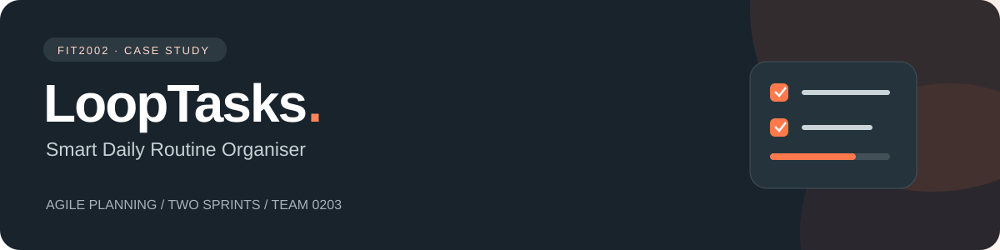
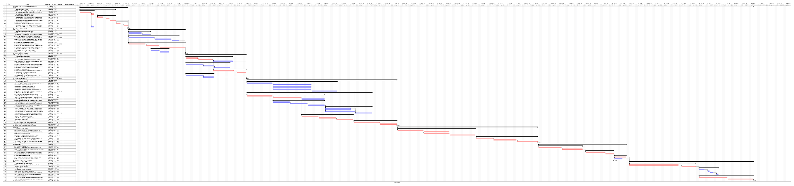
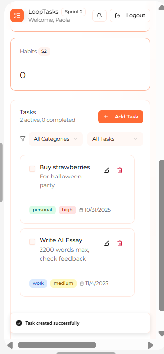
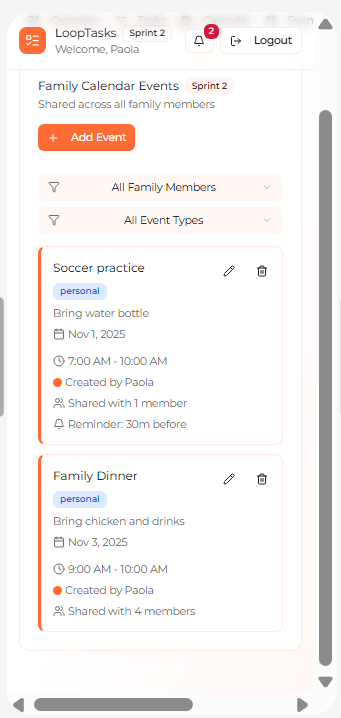
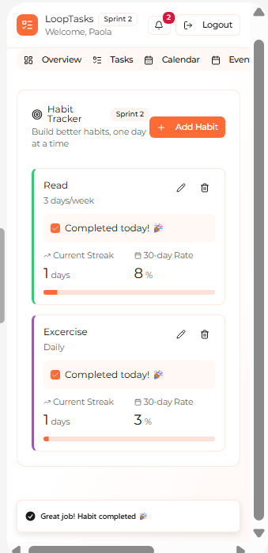

  

  <strong>Tasks, shared calendars and habits in one connected routine.</strong> 
  A FIT2002 IT Project Management group project at Monash University.

  <a href="#project-planning--assignment-1">Project planning</a> ·
  <a href="#product-preview">Product preview</a> ·
  <a href="#sprint-delivery">Sprint delivery</a> ·
  <a href="#my-contribution">My contribution</a> ·
  <a href="#read-the-documents">Read the reports</a>

---

## At a glance

| Context | Details |
| :--- | :--- |
| Project | LoopTasks: Smart Daily Routine Organiser |
| Course | FIT2002 — IT Project Management |
| Team | 0203 · Four contributors |
| Portfolio author | Guang Quan Tan (William) |
| Documented role | A1: project planning contributor · A2: developer — data persistence, integration and testing |
| Focus | Agile planning, user stories, acceptance criteria, sprint execution and reflection |
| Repository contents | A1 planning report and feedback; A2 delivery report; original visual evidence |

> **About this showcase:** This repository presents the team's coursework and documented prototype evidence. It does not contain the application source code or a live, runnable app. Product and delivery descriptions below summarise the submitted report; they are not independently verified production results.

## The problem

Daily routines become difficult to coordinate when tasks, calendars and habits are spread across separate tools. The report frames this as a challenge for individuals and families in the LifeLoop project scenario.

LoopTasks brings those activities into one routine organiser. The two documented sprints move from basic task management toward family collaboration and habit tracking.

## Project planning — Assignment 1

Assignment 1 defines the project plan; Assignment 2 documents the team's sprint work. Both concern the LifeLoop coursework scenario.

| Planning artefact | Evidence in Assignment 1 |
| :--- | :--- |
| Working agreement and project charter | Team responsibilities, communication, purpose and governance |
| Requirements and scope | RTM, acceptance criteria, deliverables, exclusions and constraints |
| WBS and Gantt chart | Work packages, dependencies, milestones and an 18-month proposed schedule |
| Cost model and baseline | Bottom-up and parametric estimates; **$297,560** proposed total against a **$300,000** cap |
| Risk management | Probability–impact analysis, risk responses and ownership |
| Hybrid delivery approach | High-level planning and budgeting combined with iterative design, build and testing |

The schedule and costs are **coursework planning assumptions**, not actual delivery duration or expenditure.

### Schedule preview

*From the Gantt Chart section, printed p. 30. Select the image to enlarge it.*

### My planning contribution

My individual reflection documents work on the **WBS, Gantt chart and cost model**, support for the **risk register**, and responsibility for **combining the final report and providing technical support**. The supplied feedback also recognises the WBS, Gantt, cost model and integration contribution.

### Assessment and improvements

**Assignment 1: 80.20 / 100.00**, as recorded in the supplied feedback. This is the assignment result, not an individual criterion score or a prototype performance metric.

| Feedback theme | Key observation |
| :--- | :--- |
| Strengths | Structured planning, clear scope and exclusions, and a detailed risk register with probability–impact analysis |
| Requirements | Add step-by-step verification cases and justify high-level requirements such as adaptive scheduling |
| Budget | Clearly distinguish the proposed $297,560 estimate from the $300,000 cap |
| Reflection | Analyse decisions and define practical future actions instead of relying on description |

[Read Assignment 1 →](docs/assignment-1-report.pdf) · [Read assessment feedback →](docs/assignment-1-feedback.pdf)

## Product preview

Actual screenshots extracted from the submitted group report. Select an image to view it at full size.

<table>
  <tr>
    <th align="left">01 · Task management</th>
    <th align="left">02 · Family calendar</th>
    <th align="left">03 · Habit tracking</th>
  </tr>
  <tr>
    <td valign="top"></td>
    <td valign="top"></td>
    <td valign="top"></td>
  </tr>
  <tr>
    <td>Create, view and maintain daily tasks.</td>
    <td>Coordinate events and reminders with family members.</td>
    <td>Track recurring habits and daily progress.</td>
  </tr>
</table>

*Source: report Figures 3, 5 and 7 (printed pages 15, 17 and 19). These are prototype screenshots, not an interactive demo.*

## Sprint delivery

| Stage | Documented goal | Evidence in the report |
| :--- | :--- | :--- |
| Sprint 1 · Foundation | Establish login, a home dashboard and basic task management | User stories US1–US7, acceptance criteria and prototype artefacts |
| Sprint 2 · Collaboration | Extend the routine organiser with family events, habit tracking and synchronisation work | Azure DevOps backlog, planning, daily stand-ups and interface screenshots |
| Review · Improvement | Review delivery progress and identify changes for the next sprint | Burndown chart, sprint increment and Start–Stop–Continue retrospective |

### How the work was managed

- **Requirements:** User stories connect user needs with acceptance criteria; Sprint 2 applies the INVEST framework.
- **Planning:** Prioritised backlog items, estimates and task ownership define the sprint scope.
- **Execution:** Stand-up records capture completed work, next steps, blockers and resolutions.
- **Validation:** The Definition of Done and review activities connect implementation with expected behaviour.
- **Reflection:** Retrospective actions address scope, communication, estimation and stakeholder feedback.

## My contribution

The planning contributions above concern **Assignment 1**. The following table concerns **Assignment 2**.

The group report identifies **Guang Quan Tan (William)** as a developer and attributes the following work to me:

| Area | Documented contribution | Report reference |
| :--- | :--- | :--- |
| Login integration | Integration testing of user data and the Room database | Figure 1 · printed p. 14 |
| Task persistence | Backend logic for saving tasks and managing task data | Figures 2–3 · printed pp. 14–15 |
| Shared events | Storage and synchronisation of event data between users | Figure 4 · printed p. 16 |
| Habit persistence | Saving and retrieving newly created habits in the local database | Figure 6 · printed p. 18 |
| Integration follow-up | Calendar/API work, synchronisation tests and performance validation recorded in stand-ups | Printed pp. 11–13 |

These are individual contributions within a team project. The full interface design and the entire delivery are not claimed as individual work.

## What I learned

The retrospective records practical lessons relevant to project delivery:

| Challenge | Improvement identified by the team |
| :--- | :--- |
| Too many stretch goals in one sprint | Reduce scope to protect quality |
| Stories without enough technical detail | Confirm acceptance criteria and break work into smaller subtasks |
| Delayed asynchronous reviews | Schedule earlier reviews and clarify ownership |
| Uncertain estimates | Estimate detailed subtasks to improve predictability |
| Feedback arriving late | Introduce shorter, more frequent stakeholder check-ins |

AI-assisted adaptive scheduling and full LifeLoop ecosystem integration are described as future directions in the report, rather than demonstrated completed features.

## Read the documents

| Document | Contents | Online reading |
| :--- | :--- | :--- |
| Assignment 1 · Planning report | Charter, RTM, WBS, schedule, cost and risk · 51 PDF pages | [Open report](docs/assignment-1-report.pdf) |
| Assignment 1 · Assessment feedback | Grade and rubric feedback · 18 PDF pages | [Open feedback](docs/assignment-1-feedback.pdf) |
| Assignment 2 · Sprint delivery report | Planning, execution, screenshots and retrospective · 27 PDF pages | [Open report](docs/project-report.pdf) |

These links open repository file pages for GitHub PDF preview, with an optional download button. PDF page counts may differ from printed page labels. The new Assignment 1 reading copies retain all pages and remove student-number text and email addresses. The Assignment 2 copy removes student-number text and compresses embedded images.

Original attachments and assessment feedback

The original links previously listed in this repository are retained below. These attachment links may download directly.

- [Original submitted report — A2_0203.pdf](https://github.com/user-attachments/files/35060345/A2_0203.pdf)
- [Original assessment feedback PDF](https://github.com/user-attachments/files/35060343/FIT2002_Assignment.2.-.Part.1.-.Written.and.video.submission.Group.component._feedback.pdf)

The original attachments are unchanged and may contain identifying details absent from the reading copy.

## Team and attribution

The report credits **Paola Varela Hernández, Guang Quan Tan (William), Shengming Wang and Vera S. Acevedo Gómez**.

The report and screenshots are coursework artefacts credited to their original contributors. This showcase does not grant a new licence to the team's work.
